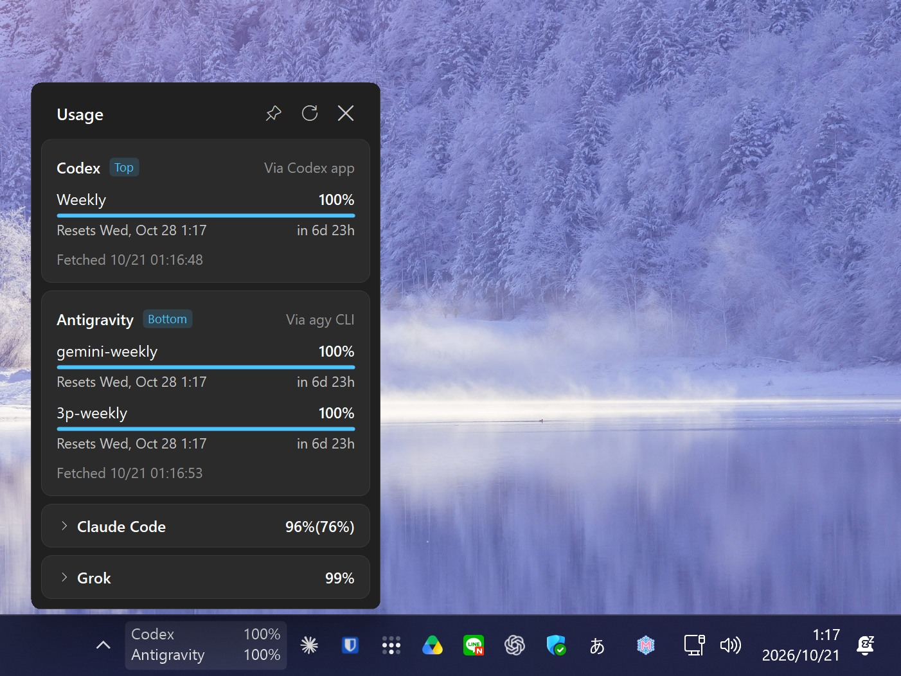
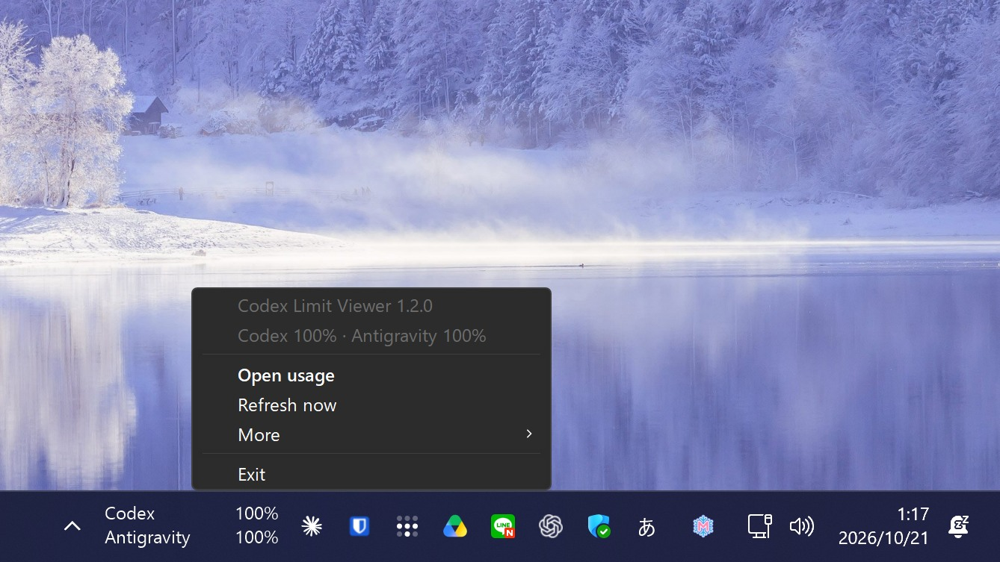

# Usage Limit Viewer

[日本語](README.md) | English

Usage Limit Viewer shows how much of your AI usage limits is left as two lines in the Windows 11 system tray (taskbar). Choose the two services to show from Codex, Antigravity CLI, Claude Code, and Grok Build CLI.


## Quick install

**Ask an AI agent**: tell Claude Code, Codex, or another agent:

> Install https://github.com/hinatamaxxx/usage-limit-viewer.

**Install it yourself**: run this line in PowerShell (no need to run as administrator):

```powershell
irm https://raw.githubusercontent.com/hinatamaxxx/usage-limit-viewer/main/get.ps1 | iex
```

It downloads the latest version, checks its SHA-256, and installs it into `%LOCALAPPDATA%\Programs\UsageLimitViewer`. It also turns on startup at Windows sign-in. A finished screen appears at the end; click **Done** to start the app.

## Features

- See your remaining quota in the taskbar while you work.
- Click to open “Usage” with each service's remaining quota, reset time, and last fetch time.
- Choose the services to show by dragging and dropping cards in “Usage”.
- New versions install themselves.
- Japanese and English.



## Prepare your services

**Set up only the services you want to display.** CLI tools are not bundled with this app. Sign in to an account with a quota for each service you use.

| Service | What you need |
| --- | --- |
| Codex | Install and sign in to the Codex desktop app or [Codex CLI](https://github.com/openai/codex) (npm installs work too). |
| Antigravity | Install and sign in to [Antigravity CLI (agy)](https://antigravity.google/docs/cli-install). See the limitation below. |
| Claude | Install [Claude Code CLI](https://code.claude.com/docs/en/setup) and run `claude auth login`. To show quota for your Claude Desktop or web account, sign in to the CLI with the same account. |
| Grok | Install the [official Grok Build CLI](https://docs.x.ai/build/cli/reference) and run `grok login`. The app displays the CLI's weekly quota. |

Antigravity quota may be unavailable with some agy versions. With agy 1.2.12, the quota command can run as a model prompt and consume quota. If the app detects this, it stops fetching Antigravity until the app is restarted.

### Keep the display visible

In Windows **Settings → Personalization → Taskbar → Other system tray icons**, turn on **all four tray icons** for this app. Keep the four icons adjacent to form the two-row quota display.

## Using the app



| Action | Result |
| --- | --- |
| Left-click | Open “Usage”. Click again or outside the popup to close it. |
| Right-click | The menu starts with your current quota. Besides “Open usage” and “Refresh limits now”, value order, hover behavior, startup and language are under “More”, and updates under “Updates”. “Exit the app” asks for confirmation first. |
| Enable “Open details on hover” | Hover over the quota display to open “Usage”. Move the pointer outside both the display and the popup to close it. |

“Usage” shows each service with remaining-quota bars. Drag and drop cards to reorder them: **the first card is the taskbar’s top row and the second its bottom row** (tagged “Top” and “Bottom”). Cards from the third on fold to one line; click one to open it. The order is saved.

For Codex and Claude plans with both 5-hour and weekly quotas, a value such as “20%(80%)” shows 5-hour remaining first and weekly remaining in parentheses. Choose “More” → “Value order” → “Weekly (5-hour) order” to reverse the order.

Quota normally refreshes every minute (every three minutes for Antigravity and Grok, which start their CLIs to fetch). Fetching pauses while the screen is locked or the PC sleeps and refreshes as soon as you return. During rate limits, the app keeps the last values. Previously fetched values turn gray if fetching fails; “—” means no value has been fetched yet.


## Startup and updates

- **Startup**: on after installing. Switch it under “More” → “Start with Windows” in the right-click menu. You can also turn it on or off in Windows **Settings → Apps → Startup** or Task Manager; the menu check mark shows the same state.
- **Updates**: the app checks for a new version once a day and, when there is one, swaps it in and restarts (no administrator rights). Only files matching the release's SHA-256 are used. Successful updates are silent; you are told only if updating fails twice in a row. “Updates” in the right-click menu has “Check and update now” and an “Update automatically (daily)” switch. When automatic updates are off, the app tells you a new version is available.

## If Claude quota is missing

First run `claude auth login` in Claude Code CLI to check your sign-in. The app normally uses this sign-in to fetch 5-hour and weekly quota. Quota is account-wide, so usage from Claude Desktop and the web is included.

Automatic fetching uses an undocumented Anthropic API that may change. If it becomes unavailable, enable the [official status line](https://code.claude.com/docs/en/statusline) bridge to display quota supplied after Claude Code CLI responses. Run this once in PowerShell:

```powershell
powershell -NoProfile -ExecutionPolicy Bypass -File "$env:LOCALAPPDATA\Programs\UsageLimitViewer\EnableClaudeCode.ps1"
```

## Data and sign-ins

Settings and quota cache are stored on this PC. The app uses Claude's sign-in only for quota requests and authentication renewal with Anthropic. If it expires, the app renews the CLI sign-in and writes it back to the CLI credentials file. Credentials are not copied to a separate app-owned location or written to logs.

### Registry and files the app changes

| Kind | Location |
| --- | --- |
| Registry | `HKCU\Software\Microsoft\Windows\CurrentVersion\Uninstall\UsageLimitViewer` (the Installed apps entry; nothing else is written) |
| Program | `%LOCALAPPDATA%\Programs\UsageLimitViewer` |
| Settings | `%APPDATA%\UsageLimitViewer\settings.json` |
| Quota cache, update record, diagnostics, status-line bridge script | `%LOCALAPPDATA%\UsageLimitViewer` |
| Start menu | `%APPDATA%\Microsoft\Windows\Start Menu\Programs\Usage Limit Viewer.lnk` |
| Startup (only when on) | `Usage Limit Viewer.lnk` in the Startup folder |

When you switch startup in Windows settings, Windows itself records that choice. The app only reads it and never changes it.

## Uninstalling

In Windows **Settings → Apps → Installed apps**, select “Usage Limit Viewer” and click **Uninstall**. By default, settings and quota cache are removed too; turn on “Keep settings and data” to carry them over to a reinstall. Progress and the result appear in the same window. The Claude Code status-line bridge script is kept because Claude Code's settings may point to it.

To run it from a command line, use `"%LOCALAPPDATA%\Programs\UsageLimitViewer\UsageLimitViewer.exe" --uninstall --silent`. Add `--keep-settings` to keep settings.

## Requirements and limitations

- Unofficial, unsigned app for Windows 11. It runs on .NET Framework 4.8, which is part of Windows, so nothing else needs installing (the app is about 1.4 MB).
- Mixed-DPI monitors and startup after a reboot are unverified.
- Service or CLI changes may prevent quota fetching. Grok support covers the Grok Build CLI weekly quota, not separate per-chat limits on the web.
- Provided as is. Bug and security reports, questions, and requests are not accepted (use at your own risk, as stated in the [MIT License](LICENSE)).

Development assistance: Codex (GPT-6 Sol / Medium, GPT-6.1 Sol / Ultra and High) and Claude Code (Claude Opus 5.5 / Medium). Japanese and English proofreading: Gemini 3.8 Flash (High) / High. The values following each model name are reasoning-effort settings.
