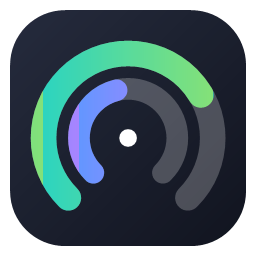
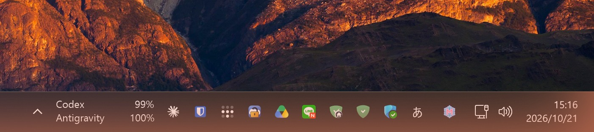
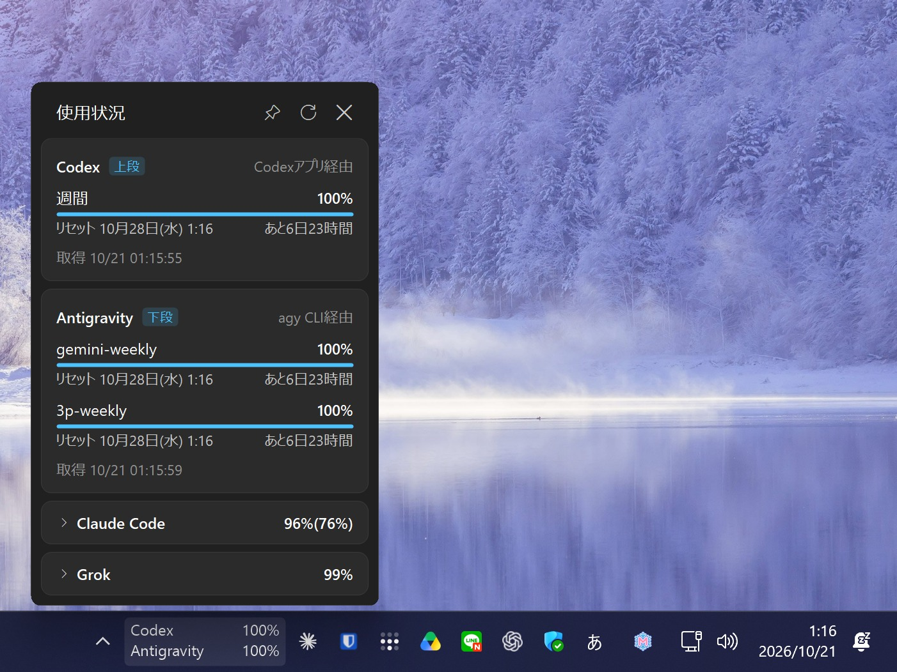
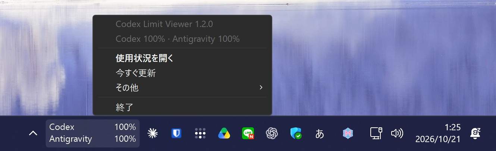
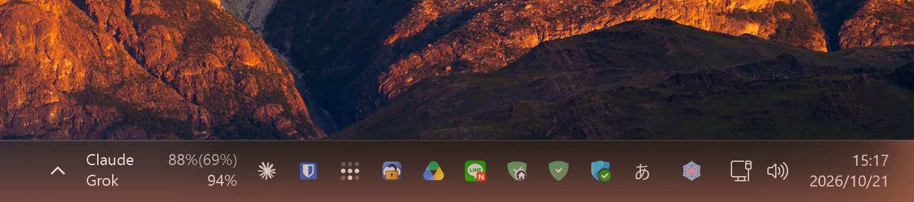

# Usage Limit Viewer

日本語 | [English](README.en.md)

Windows 11の通知領域（タスクバー）に、AIサービスの利用枠の残り割合を2行で表示するアプリです。Codex、Antigravity CLI、Claude Code、Grok Build CLIから、表示する2つのサービスを選べます。

*Shows how much of your AI usage limits is left (Codex, Antigravity CLI, Claude Code, Grok Build CLI) as two lines in the Windows 11 taskbar.*



## かんたん導入

**AIに頼む**: Claude CodeやCodexなどのAIエージェントに、次のように伝えてください。

> https://github.com/hinatamaxxx/usage-limit-viewer を導入して。

**自分で入れる**: PowerShellで次の1行を実行します（管理者として開く必要はありません）。

```powershell
irm https://raw.githubusercontent.com/hinatamaxxx/usage-limit-viewer/main/get.ps1 | iex
```

最新版をダウンロードし、SHA-256を照合してから`%LOCALAPPDATA%\Programs\UsageLimitViewer`にインストールします。Windowsへのサインイン時の自動起動もオンになります。最後に完了の画面が出るので、「完了」を押すとアプリが起動します。

## できること

- 作業中も、タスクバーで残量をひと目で確認できます。
- クリックすると「使用状況」を開き、サービスごとの残量、リセット日時、最終取得時刻を表示します。
- 表示するサービスは、「使用状況」のカードをドラッグ＆ドロップして選べます。
- 新しい版は自動で更新されます。
- 日本語と英語に対応しています。



## 利用するサービスの準備

**表示したいサービスだけ準備してください。** CLIツールは本アプリには同梱していません。各サービスの利用枠があるアカウントへのログインが必要です。

| サービス | 準備するもの |
| --- | --- |
| Codex | Codexデスクトップアプリ、または[Codex CLI](https://github.com/openai/codex)（npm版も可）をインストールしてログインします。 |
| Antigravity | [Antigravity CLI（agy）](https://antigravity.google/docs/cli-install)をインストールしてログインします。下記の制限もご確認ください。 |
| Claude | [Claude Code CLI](https://code.claude.com/docs/en/setup)をインストールし、`claude auth login`でログインします。Claude DesktopやWeb版で使っているアカウントも、同じアカウントでCLIにログインすれば残量を表示できます。 |
| Grok | [公式Grok Build CLI](https://docs.x.ai/build/cli/reference)をインストールし、`grok login`でログインします。対象はCLIの週次利用枠です。 |

Antigravityは、agyのバージョンによって残量を取得できない場合があります。agy 1.2.12では、残量取得のコマンドがモデルへの依頼として実行され、利用枠を消費することがあります。本アプリはこれを検出すると、その起動中はAntigravityの取得を停止します。

### 通知領域に常時表示する

Windowsの「設定」→「個人用設定」→「タスクバー」→「その他のシステム トレイ アイコン」で、本アプリの**4つのトレイアイコンをすべてオン**にしてください。4つが隣り合うように並べると、2行の残量表示になります。

## 使い方



| 操作 | 動作 |
| --- | --- |
| 左クリック | 「使用状況」を開きます。もう一度クリックするか、画面の外側をクリックすると閉じます。 |
| 右クリック | 先頭に今の残量を表示します。「使用状況を開く」「残量を今すぐ取得」のほか、残量の表示順・ホバー表示・自動起動・言語は「その他」に、更新は「アップデート」にあります。「アプリを終了する」は確認画面のあとにアプリを終了します。 |
| 「ホバーで詳細を開く」をオン | 残量表示にカーソルを合わせると「使用状況」を開きます。残量表示と「使用状況」の両方からカーソルを離すと閉じます。 |

「使用状況」では、サービスごとに残量をバーで表示します。カードはドラッグ＆ドロップで並べ替えられ、**1番目のカードがタスクバーの上段、2番目が下段**に表示されます（「上段」「下段」のタグが付きます）。3番目以降は1行に折りたたまれ、クリックすると内容を開けます。並べた順番は保存されます。

CodexとClaudeで5時間枠と週間枠がある場合は、「20%(80%)」のように表示します。先頭は5時間枠、括弧内は週間枠の残量です。「その他」→「残量の表示順」で「週間（5時間）の順」に切り替えられます。

残量は通常1分ごとに更新されます（AntigravityとGrokは、CLIを起動して取得するため3分ごと）。画面のロック中とスリープ中は取得を止め、戻ったときにすぐ更新します。問い合わせ制限中は前回の値を表示します。取得できなくなった値はグレーで表示し、まだ取得できていない場合は「—」と表示します。



## 自動起動と更新

- **自動起動**: インストールするとオンになります。右クリックメニューの「その他」→「Windows起動時に自動起動」で切り替えられます。Windowsの「設定」→「アプリ」→「スタートアップ」やタスクマネージャーからもオン/オフでき、メニューのチェックも同じ状態を表示します。
- **更新**: 1日に1回新しい版を確認し、あれば自動で入れ替えて再起動します（管理者の権限は使いません）。リリースのSHA-256と一致したものだけを使います。成功しても通知はせず、2回続けて失敗したときだけ通知します。右クリックメニューの「アップデート」で、「今すぐ確認して更新」と「自動で更新する（毎日）」のオン/オフができます。オフにしている場合は、新しい版があることを通知します。

## Claudeの残量が表示されない場合

まず、Claude Code CLIで`claude auth login`を実行し、ログインを確認してください。通常は、そのログイン情報を使って5時間・週間の残量を取得します。残量はアカウント全体の値なので、Claude DesktopやWeb版での利用も反映されます。

自動取得に使うAnthropicのAPIは非公開で、仕様変更により取得できなくなる場合があります。その場合は、[公式status line](https://code.claude.com/docs/en/statusline)の連携を有効にすると、Claude Code CLIの応答後に届く残量を表示できます。PowerShellで次を一度実行してください。

```powershell
powershell -NoProfile -ExecutionPolicy Bypass -File "$env:LOCALAPPDATA\Programs\UsageLimitViewer\EnableClaudeCode.ps1"
```

## データとログイン情報

設定と残量キャッシュはこのPCに保存します。Claudeのログイン情報はAnthropicへの残量取得・認証更新に使用します。有効期限が切れた場合はCLIのログイン情報を更新し、CLIの認証ファイルに書き戻します。本アプリ専用の場所に認証情報を保存したり、ログに記録したりすることはありません。

### 変更するレジストリとファイル

| 種類 | 場所 |
| --- | --- |
| レジストリ | `HKCU\Software\Microsoft\Windows\CurrentVersion\Uninstall\UsageLimitViewer`（「インストールされているアプリ」への登録。これ以外は書きません） |
| プログラム本体 | `%LOCALAPPDATA%\Programs\UsageLimitViewer` |
| 設定 | `%APPDATA%\UsageLimitViewer\settings.json` |
| 残量キャッシュ、更新の記録、診断結果、status line連携用スクリプト | `%LOCALAPPDATA%\UsageLimitViewer` |
| スタートメニュー | `%APPDATA%\Microsoft\Windows\Start Menu\Programs\Usage Limit Viewer.lnk` |
| 自動起動（オンのときだけ） | スタートアップフォルダーの`Usage Limit Viewer.lnk` |

自動起動のオン/オフをWindowsの設定で切り替えると、Windows自身がスタートアップの状態を記録します。アプリはこれを読むだけで、書き換えません。

## アンインストール

Windowsの「設定」→「アプリ」→「インストールされているアプリ」で「Usage Limit Viewer」を選び、「アンインストール」をクリックします。初期設定では、設定と残量キャッシュも削除します。再インストールで引き継ぎたい場合は「設定とデータを残す」をオンにしてください。進み具合と完了は同じ画面に表示されます。Claude Codeのstatus line連携用スクリプトは、Claude Codeの設定から参照されているため残します。

コマンドで実行する場合は、`"%LOCALAPPDATA%\Programs\UsageLimitViewer\UsageLimitViewer.exe" --uninstall --silent`です。設定を残すときは`--keep-settings`を付けます。

## 対応環境・注意事項

- Windows 11向けの非公式・未署名アプリです。Windowsに標準で入っている.NET Framework 4.8で動くため、追加のインストールは不要です（アプリは約1.4MB）。
- 異なる表示倍率の複数モニターと、再起動後の自動起動は動作未確認です。
- 各サービスの仕様やCLIの更新により、残量を取得できなくなる場合があります。Grokの対象はGrok Build CLIの週次利用枠で、Web版チャットの個別回数制限ではありません。
- 現状のまま公開しています。不具合・脆弱性の報告、質問、要望は受け付けていません（[MITライセンス](LICENSE)の免責のとおり、自己責任でご利用ください）。

制作協力: Codex（GPT-6 Sol / Medium、GPT-6.1 Sol / Ultra・High）、Claude Code（Claude Opus 5.5 / Medium）。日本語・英語の公開文の校正: Gemini 3.8 Flash (High) / High。各モデルの後ろに記載した値は推論設定です。
